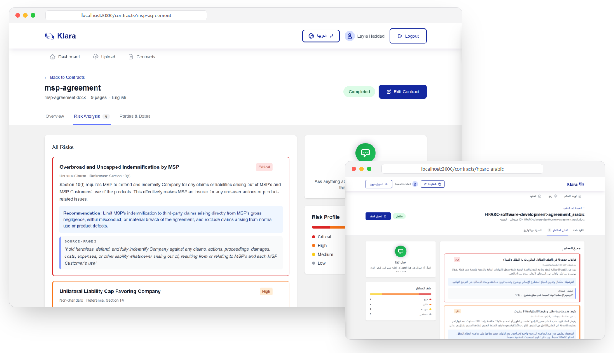
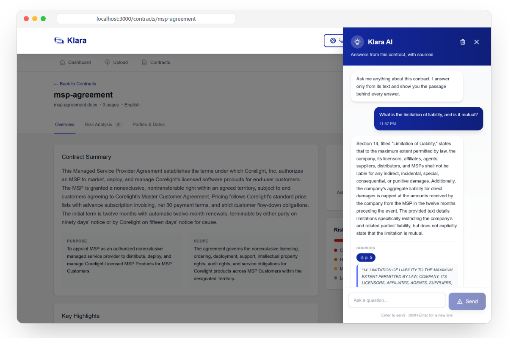
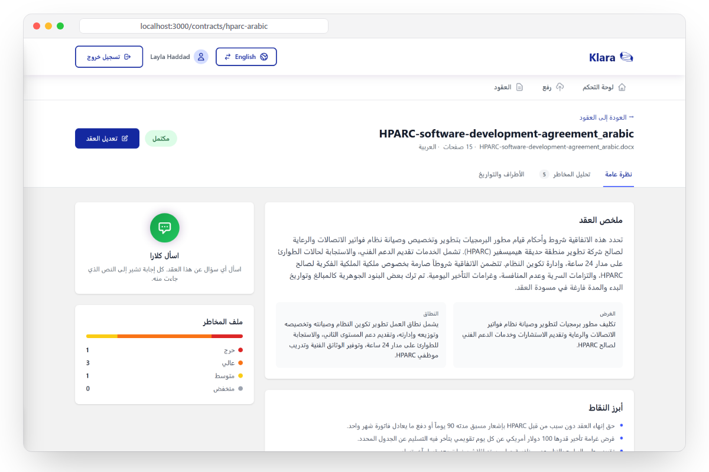
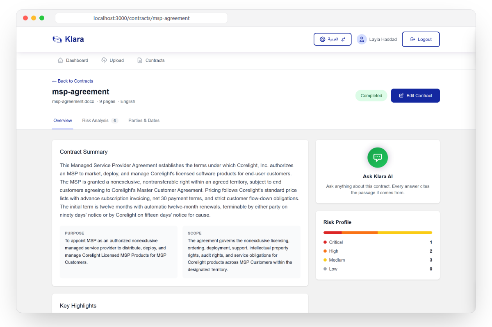
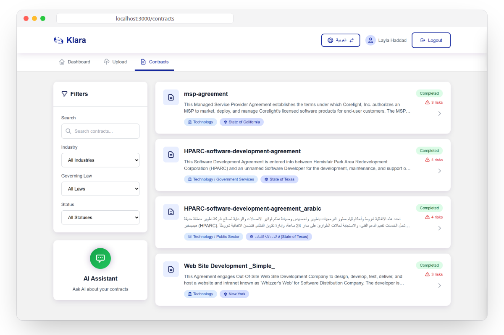
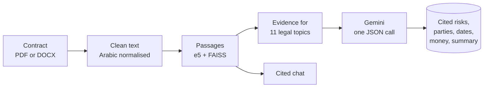

<picture>
  <source media="(prefers-color-scheme: dark)" srcset="./.github/assets/banner-dark.svg">
  <source media="(prefers-color-scheme: light)" srcset="./.github/assets/banner-light.svg">
  
</picture>

<p align="center">
  <b>Upload a contract in Arabic or English. Klara finds the parties, dates, money terms and risks,<br>and points to the exact passage behind every one of them.</b>
</p>

<p align="center">
  <a href="#see-it-work">See it work</a>
  &nbsp;·&nbsp;
  <a href="#why-this-is-hard">Why this is hard</a>
  &nbsp;·&nbsp;
  <a href="#run-it-locally">Run it locally</a>
</p>

<p align="center">
  
  
  
  
  
</p>

<br>

<a id="see-it-work"></a>



<br>

## Page 31.

A legal officer in Doha opens a 40-page supply agreement. Half of it is in Arabic. The clause that caps the supplier's liability, or quietly doesn't, is somewhere around page 31.

She has two options. Read all 40 pages. Or paste it into a chatbot that gives a confident summary, with no way to check where any of it came from.

In law, an answer you can't verify is worth nothing. And more than 400 million people speak Arabic, while almost every contract tool is built for English first.

**Klara doesn't just summarise. It cites.**

<br>

## Meet Klara

**1. Upload.** A PDF or Word contract, in Arabic or English.

**2. Read.** Klara cleans the text, splits it into passages, and pulls the passages that matter for 11 legal topics: payment, warranty, indemnity, liability caps, confidentiality, data protection under GDPR and Gulf PDPL, termination, governing law, force majeure, IP, and change of control.

**3. Cite.** One Gemini call turns those passages into parties, dates, money terms, risks and a summary, and every point has to name the passage it came from. Then ask questions in either language, and get answers with their sources attached.

<table>
  <tr>
    <td width="50%" valign="top">
      
      <br><b>Ask, and see the source.</b> Every answer comes with the page and passage it is based on. Citations to text Klara never retrieved are thrown away.
    </td>
    <td width="50%" valign="top">
      
      <br><b>Arabic is not a translation layer.</b> An Arabic contract, analysed in Arabic, in an interface that flips fully right to left.
    </td>
  </tr>
  <tr>
    <td width="50%" valign="top">
      
      <br><b>The contract on one screen.</b> Summary, purpose, scope, governing law and money terms, each money term with its quoted source.
    </td>
    <td width="50%" valign="top">
      
      <br><b>The whole portfolio at a glance.</b> Filter by industry, governing law and status, with each contract's risk count on its card.
    </td>
  </tr>
</table>

<br>

## Why this is hard

**Arabic legal text breaks off-the-shelf pipelines.** Arabic-Indic digits, decorative letter stretching (tatweel), mixed-direction lines, and currencies written as ر.ق. Klara normalises all of it before anything else runs, then detects the language and embeds both languages in one shared vector space.

**Language models invent clauses.** So Klara never asks the model to read the whole contract and remember it. It retrieves the evidence first, by legal topic, hands the model only those numbered passages, and requires a citation for every claim. In chat, any citation that points outside the supplied passages is dropped before you see it.

<br>

## Under the hood



<details>
<summary><b>Real output: the six risks Klara found in the sample MSP agreement</b></summary>

<br>

From [`msp-agreement.docx`](./backend/src/data_samples/english/msp-agreement.docx), a 9-page reseller agreement. Every row links back to a quoted passage on the page shown.

| Severity | Risk | Source |
|---|---|---|
| Critical | Overbroad and uncapped indemnification by the MSP | page 3: *"hold harmless, defend, and fully indemnify Company against any claims..."* |
| High | Liability cap that protects only the vendor | page 5: *"IN NO EVENT SHALL COMPANY'S AGGREGATE LIABILITY FOR DIRECT DAMAGES..."* |
| High | Restrictive conflict of interest clause | page 6: *"MSP will not accept work, enter into a contract..."* |
| Medium | 48-hour cure period for license overages | page 3: *"MSP shall have forty-eight (48) hours to terminate the overage..."* |
| Medium | Asymmetric 15-day cure period for termination | page 5: *"Company may terminate this Agreement upon fifteen (15) days written notice..."* |
| Medium | No service levels and a narrow 90-day warranty | page 3: *"for a period of ninety (90) days from the date of shipment..."* |

</details>

- **One call, not five.** Extraction, risk review and summary share one grounded prompt, which keeps every section consistent with the same evidence.
- **Scoped to you.** Every query, including cross-contract search, only ever sees the signed-in user's contracts. JWT auth on every endpoint.
- **15 API endpoints, 8 tables, 7 screens,** with 10 paired English and Arabic sample contracts in [`backend/src/data_samples`](./backend/src/data_samples).

<br>

## Run it locally

You need Python 3.11+, Node 18+ and a [Gemini API key](https://aistudio.google.com/apikey).

```bash
# 1. API
cd backend
python -m venv .venv && source .venv/bin/activate   # Windows: .venv\Scripts\activate
pip install -r requirements.txt
cp .env.example .env          # then set GEMINI_API_KEY
python main.py                # http://localhost:8000, docs at /docs

# 2. App, in a second terminal
cd frontend
npm install
echo "NEXT_PUBLIC_API_URL=http://localhost:8000" > .env.local
npm run dev                   # http://localhost:3000
```

Sign up, upload one of the sample contracts, and open it. The first upload downloads the embedding model, so give it a minute.

<br>

## What's real, and what's next

- [x] Grounded extraction, risk review and summary, saved and shown in the app
- [x] Chat about a contract with page-level citations, in English and Arabic
- [x] Full right-to-left Arabic interface
- [x] Per-user data isolation and JWT auth
- [ ] OCR for scanned PDFs (today: text-based PDFs and Word files)
- [ ] A persistent vector store (today each contract's index is rebuilt on demand)
- [ ] An accuracy benchmark on the paired English and Arabic sample contracts
- [ ] Clause library and suggested redlines

Klara was built in one weekend. It is a working prototype, and the list above is honest about the gap.

<br>

## Team

| Name | Role |
|---|---|
| **[Anas Rustom](https://github.com/anasrustom)** | Software engineering, product, Arabic interface |
| **[Mohamed Ali](https://github.com/mohamed-ali-ai)** | AI pipeline: retrieval, analysis, chat |
| **Mahmoud Ali** | AI engineering |
| **Abdulrahman Abushahba** | Product and brand design |

<p align="center">
  <sub>Built at the <b>AIX Hackathon</b>, Doha, October 2025.</sub>
</p>
